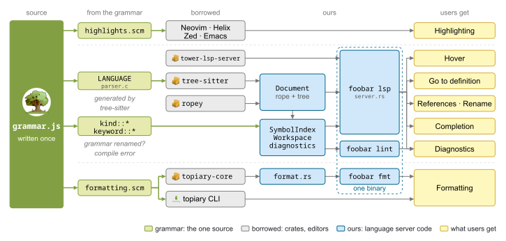

# foobar-language-server

Language server, linter and formatter for **foobar**, a small configuration language, in one Rust
binary built on a [Tree-sitter grammar](https://github.com/tfachmann/tree-sitter-foobar).

Companion code to the EuroRust 2026 talk
[*Rebuilding the Tower of Babel – Write Your Own Language Server with Tree-sitter*](https://eurorust.eu/talks/rebuilding-the-tower-of-babel-write-your-own-language-server-with-tree-sitter/).
Slides and links: [tfachmann.com/eurorust-26](https://tfachmann.com/eurorust-26).

<p align="center">
  <picture>
    <source media="(prefers-color-scheme: dark)" srcset="docs/overview-dark.svg">
    
  </picture>
</p>

## The language

```
defines
  name: "eurorust"
  program_compile: "typst"

template compile(src, dst)
  command: "%(program_compile) compile %(src) %(dst)"

process compile presentation
  use compile(src: "%(name).typ", dst: "%(name).pdf")
  cwd: 'slides'
```

Full reference: [`docs/language.md`](docs/language.md).

## Install

```sh
git clone https://github.com/tfachmann/foobar-language-server
cd foobar-language-server
cargo install --path .
```

Requires Rust 1.88 or newer.

## Usage

```sh
foobar lsp                           # language server over stdin/stdout, started by your editor
foobar lint [PATHS]                  # report findings; exit code 1 on errors
foobar lint --message-format short   # one line per finding (also: json)
foobar fmt [PATHS]                   # format in place; --check only lists what would change
```

The language server provides diagnostics, hover, go to definition, references, rename,
completion, formatting and folding.

## Editors

Setup for Neovim, Helix, Emacs, Kate, Zed and VS Code: [`editors/`](editors/README.md).

## Built on

[tower-lsp-server](https://crates.io/crates/tower-lsp-server) ·
[tree-sitter](https://crates.io/crates/tree-sitter) ·
[ropey](https://crates.io/crates/ropey) ·
[topiary-core](https://crates.io/crates/topiary-core) ·
[ariadne](https://crates.io/crates/ariadne)

The first draft was inspired and guided by [terror/just-lsp](https://github.com/terror/just-lsp).
